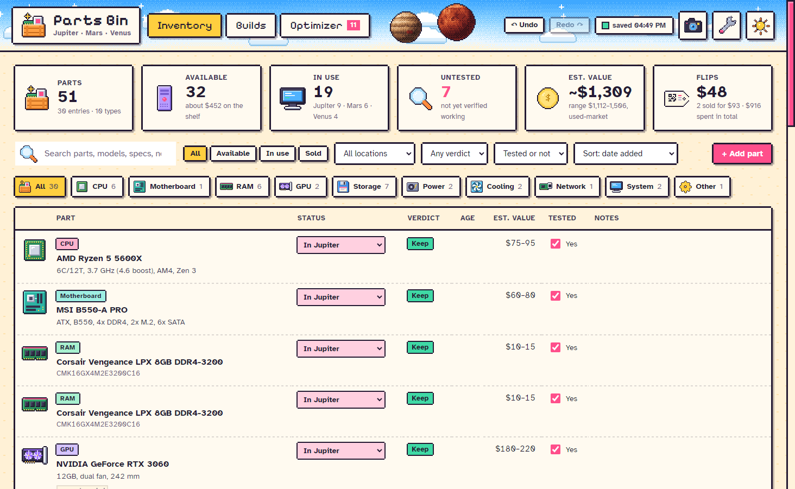
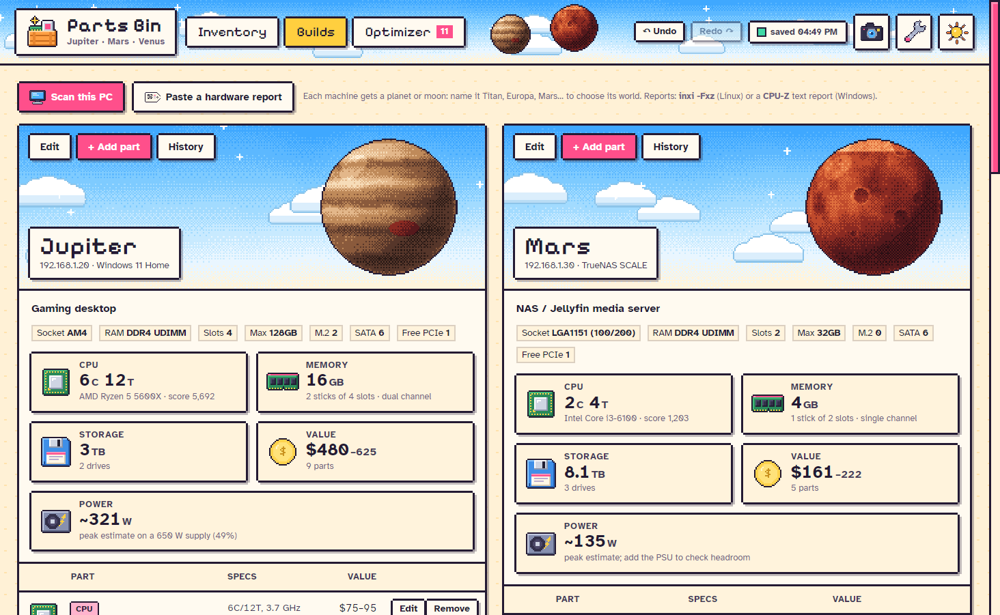
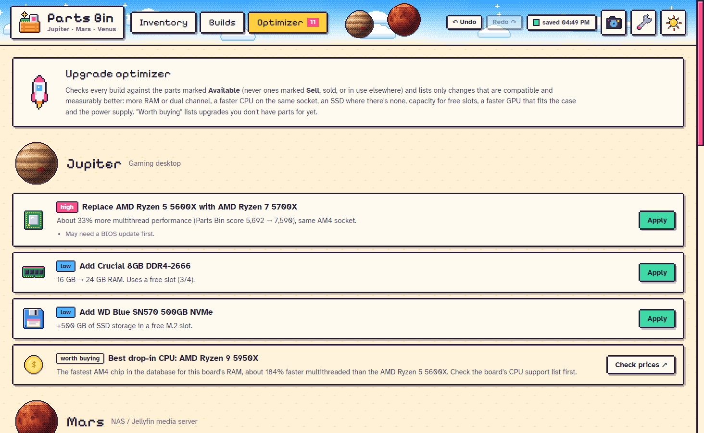

# Parts Bin

**A pixel-art hardware inventory for homelabs and PC tinkerers.** Track every part on the shelf and in your
machines, see what's in use at a glance, and let the optimizer tell you when a spare would make a build
objectively better. Free, open source (MIT), offline. No accounts, no telemetry.



## Features

- **Inventory** with instant search, filters (type, status, storage location, verdict, tested) and sorting.
  Mark parts *Available*, *In &lt;machine&gt;*, *In use elsewhere* or *Sold* right in the list.
- **Builds**: one card per machine with its platform (socket, RAM type and slots, M.2, SATA, PCIe, case limits),
  CPU / memory / storage / value / power tiles, its parts, and a history of every change.
  Every machine gets its own **planet or moon**: name it Mercury, Titan, Europa, Phobos, Pluto… and it gets that
  world's pixel art (29 to choose from); any other name gets a planet picked from the name.
- **Scan this PC** in one click (CPU, board, every RAM stick, drives with SMART health, GPU, NIC), or **paste a
  report** from another machine: `inxi -Fxz` on Linux or a CPU-Z text report on Windows. You review the parts
  before anything is added.
- **Optimizer**: only suggests changes that are compatible and measurably better, using parts you already have:
  free RAM slots and dual channel, a faster CPU on the same socket (with BIOS and cooler warnings), an SSD where
  there's none, spare drives for storage boxes, a faster GPU that fits the case and the power supply.
  Warns when a power supply is near its limit, and lists what's **worth buying** with a link to eBay sold prices.
  Spares that fit nothing are flagged as sell candidates.
- **Dev boards, single-board computers and modules**: 1,400+ microcontroller boards built in (TI LaunchPads,
  Arduino, ESP32, Raspberry Pi Pico, STM32 Nucleo, Teensy, nRF52, RISC-V…, from PlatformIO's open board list).
  Pick one and its chip, clock, flash, RAM and wireless fill in. Not in the list? **“Not here? Add it to my
  boards”** saves it so it's suggested next time. Builds can be **electronics projects** that hold boards and modules.
- **Money**: price paid, seller, warranty date, sale price; the inventory shows spend and profit on flips.
- **Photos**, a **test log** (MemTest86, SMART, Prime95…), drive health, quantities for bulk items
  (fans, cables), and **storage locations** (bins, boxes, shelves).
- **QR labels** for parts and bins (Avery 5160 / 5163), printed or saved as PDF. Point a webcam at a label and the
  app jumps straight to that part or bin.
- **PDF inventory report**, **CSV** import/export (works with hand-made spreadsheets), JSON backups,
  automatic snapshots every 10 minutes of editing, **undo/redo**, and a 30-day **trash**.
- Day and night themes, adjustable text size, reduced-motion option, keyboard shortcuts.




## Install

Download the installer for your system from the [Releases](https://github.com/d-andrew-l/parts-bin/releases) page:
`Parts-Bin-Setup-x.y.z.exe` (Windows), `.dmg` (macOS), `.AppImage` or `.deb` (Linux).
The installed app updates itself from GitHub Releases (you can turn that off in Settings).

Your data lives in a single JSON file in your user folder (`%APPDATA%\Parts Bin\data` on Windows,
`~/Library/Application Support/Parts Bin/data` on macOS, `~/.config/Parts Bin/data` on Linux), next to
`backups/` and `photos/`. Settings → *Data & backups* opens it.

## Run from source

```bash
npm install
npm start          # run the app
npm test           # parts database, importers, optimizer, migrations, CSV
npm run dist       # build an installer for this OS into dist/
```

Node 20+ is needed. Run from source, your inventory, backups and photos live in `user-data/` inside the
project (gitignored, never packaged; on first run it copies over any existing data from the installed app's
folder). The installed app keeps its data in the OS app-data folder. `PARTSBIN_DATA=/some/folder npm start`
runs against a separate data folder.

## How the optimizer scores parts

There are no proprietary benchmark numbers in this project. CPUs get a **Parts Bin score** computed from the
open specs in [`db/cpus.json`](db/cpus.json): cores × boost clock × a per-architecture IPC factor, with SMT threads
worth 25% of a core and efficiency cores weighted separately (see [`src/partsdb.js`](src/partsdb.js)). It ranks
chips sensibly across generations; it isn't a benchmark. GPUs use a rough relative `perf` index in
[`db/gpus.json`](db/gpus.json).

## Project layout

| Path | What it is |
|---|---|
| `main.js`, `preload.js` | Electron main process (files, scan, photos, printing, updates) and the IPC bridge |
| `src/app.js` | The interface: rendering, dialogs, undo/redo, printing, camera |
| `src/model.js` | Data schema, migrations, CSV |
| `src/partsdb.js` | Parts database lookups and the CPU score |
| `src/importers.js` | systeminformation / inxi / CPU-Z → parts |
| `src/optimizer.js` | Upgrade suggestions |
| `src/pixel.js` | Every sprite, drawn in code (planets, moons, icons, skies) |
| `db/` | The open parts database |
| `samples/sample-homelab.json` | Demo data (also the test fixture) |
| `test/` | Test suite and anonymised fixtures |

## Contributing

Bug reports, parts-database additions and pull requests are welcome. See [CONTRIBUTING.md](CONTRIBUTING.md).
Adding a CPU or GPU you own is the easiest first contribution.

## Credits

Board data: [PlatformIO](https://github.com/platformio) board manifests, Apache License 2.0 (see [NOTICE](NOTICE));
refresh with `node scripts/import-boards.mjs`.

Fonts: [Pixelify Sans](https://github.com/eifetx/Pixelify-Sans) and
[Atkinson Hyperlegible](https://www.brailleinstitute.org/freefont/), both under the SIL Open Font License.
Libraries: Electron, systeminformation, qrcode, jsQR, electron-updater, electron-builder.

## License

[MIT](LICENSE)
